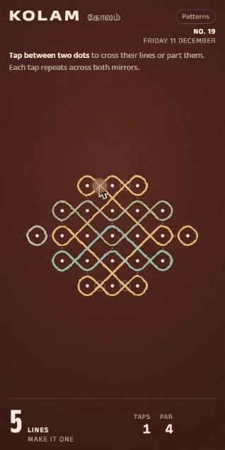

# Kolam

A daily puzzle for Reddit. A kolam is a line pattern drawn around a grid of dots at the doorstep each morning. Each day's board starts as a tangle of separate loops. Tap between two dots to cross the lines there or part them, and turn the tangle into **one unbroken line**. Every tap repeats at the board's symmetric positions (shown by faint mirror lines), every tap counts, and your score is how close you come to par. There is no undo and no fail state: everyone who keeps going finishes.

Built with Devvit Web (React, Hono, TypeScript) for Reddit's Daily Games Hackathon 2026.

  

## How it works

- One puzzle per UTC day, the same for everyone. Kolam No. 1 is Monday 23 November 2026.
- A scheduled job (00:01 UTC) generates puzzles a week ahead, stores them, and posts the day's puzzle with a pinned results comment. Moderators can run it by hand with the subreddit menu item **Post today's Kolam**.
- Difficulty follows the week: Monday is gentle, Friday and Saturday need a "sideways" tap, Sunday is the big board.
- No puzzle is ever issued twice, including rotated or mirrored copies.
- Completion is decided on the server by replaying the player's taps. The solver never ships to the browser.
- When you finish, the result card shows your taps against par, your **trail** (the loop count after each tap, for example `13 › 9 › 5 › 1`), how many players matched par, your streak, and when the next puzzle arrives.
- **Comment my result** posts your trail as a reply to the pinned results comment, as you, after you confirm the exact text. Add a message and it posts as a top-level comment instead. **Join** subscribes you to the subreddit. Both are optional and separate from play.
- **Hints need a login.** A hint highlights one gap from a shortest solution from where you are now; you still tap it, and it is counted on your result.
- Logged-out players can play and finish; their progress stays in the browser. **Log in to keep a streak** opens Reddit's login.
- Accessibility: every gap is a keyboard control with a spoken label, loop counts are announced, and **Patterns** gives every loose loop a dash pattern as well as a colour.

## What it stores

Per subreddit installation, in Devvit Redis:

| Key | Content |
| --- | --- |
| `puzzle:{day}` | the day's puzzle (layout, symmetry, start pattern, par, signature) |
| `puzzle:sigs` | signature → day, so no puzzle repeats |
| `puzzle:ahead` | highest day generated |
| `day:post`, `post:day` | day ↔ post id |
| `post:sticky` | post id → the app's pinned results comment |
| `prog:{day}` | user id → taps, hints used, finished |
| `stats:{day}` | players, solved, and taps over par (0 to 5+) |
| `streak` | user id → current streak, best streak, last day |
| `sub` | user id → subscribed through the app |
| `commented:{day}` | user id → the player's score comment id |
| `lock:post:{day}` | short-lived lock so only one post is made per day |

Only Reddit user ids are kept; no names or other personal data. Logged-out progress stays in the browser's storage and never reaches the server. Usage events (Devvit Journeys: app ready, first tap, progress, hint, finish) carry no user ids, names or post ids.

## Notes for testers

- **Comments during playtest:** until the app version is approved, comments by testers other than the app owner are posted from the app account. The owner's comments appear as the owner.
- The app is uploaded for playtest only. It is **not submitted for publishing**.

## Contact

Send modmail to the subreddit where Kolam is installed (r/kolamdaily_dev during development).

## Development

- `npm test`: unit and service tests (Vitest, `@devvit/test`)
- `npm run test:types`, `npm run lint`, `npm run build`
- `npm run dev`: playtest on Reddit
- `npm run preview`: local preview of the game screen with no Reddit. Plays the real puzzle for any day (the same generator and day order as production), with Prev/Next, jump to day, Reset and Auto-solve. Keys: `[` `]` change day, `h` hides the panel. Progress is kept in that browser only. Dev-only; it never ships in the app.
- `npm run deploy`: type-check, lint, upload. Do not run `npm run launch`.

## Status

Automated (117 tests): every reference test vector and the 400-day invariants; daily job idempotence, racing runs, pre-launch install, buffer depth and run time; tap replay, retries, conflicts, stats and streaks; comment claim, double-post protection and pinned-comment recovery; hints, including the biggest boards (under 50 ms); Journeys validation and fire-and-forget behaviour; tap queue, guarded storage, countdown and announcements.

Checked in the local preview: no scroll or clipping at 360×640, 390×844 and 1280×800, before and after solving; self-hosted fonts load, including Anek Tamil.

Build spec §10 acceptance (pass = verified; pending = needs playtest on Reddit):

| Item | Status |
| --- | --- |
| Daily job twice → one post, one puzzle | pass (tests) |
| `puzzle:{day}` never overwritten | pass (tests) |
| Distinct signatures; no consecutive layout | pass (tests) |
| Buffer ≥ 7 days ahead; job under 10 s | pass (tests) |
| Old post shows its puzzle; no streak change | pass (tests) |
| Tap toggles one orbit; shown count = loops | pass (tests) |
| Reload restores board and taps (logged in) | pass (tests); pending on Reddit |
| Same tap twice appends once | pass (tests) |
| Done only when replay leaves one loop | pass (tests) |
| Taps rejected after done; result card shows | pass (tests); pending on Reddit |
| Hint is part of a shortest solution | pass (tests) |
| No scroll/clipping at the three sizes | pass (game, local preview); splash pending |
| Feed to first tap in one click | pending |
| Keyboard-only play to the result card | pending |
| Reduced motion removes animations | pending |
| Logged-out player can finish | pending |
| Mobile web, iOS app, Android app | pending |
| §9 compliance (no Snoo, user actions, no publish) | pass (code review); pending on Reddit |
